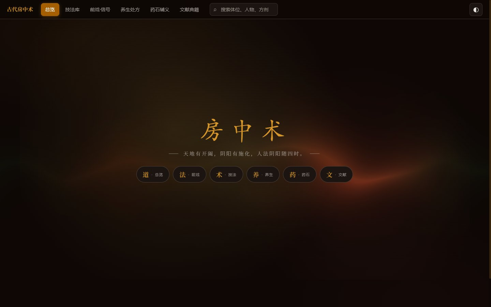

# 房中术 · Fangzhongshu

**An open-source, offline-first knowledge dashboard on classical Chinese sexual cultivation (房中術 / 房中术).**

Classical Chinese medicine treated sexual health as part of preventive medicine. A body of texts compiled between the Han and Tang dynasties (《素女经》, 《玉房秘诀》, 《素女方》, and their Japanese preservation in 《医心方》) records detailed observation of sexual physiology, arousal signals, and health practices. This project turns that scattered corpus into a browsable, single-page dashboard: classical quotations alongside modern interpretation, techniques, health practices, materia medica, and a source library.

**Why open source?** In both Chinese and English, this knowledge is either vulgarized into listicles or buried in unsearchable scans and out-of-print editions. There is no structured, citable, community-maintained edition that anyone can read, correct, and extend. This project aims to be that edition — every claim traceable to a classical or modern source, every correction reviewable in public.

> **Note** — Educational content on sexual health and classical medicine. Not medical advice. Designed for adult readers; contains classical artwork and non-explicit schematic silhouettes maintained separately (see [Licensing](#licensing)).

## Online demo

Live: **https://Lanren152.github.io/fangzhongshu/** (GitHub Pages, auto-deployed from `main`)

## Screenshots




## What's inside

Six sections, 59 techniques, 134 cards:

| Section | Coverage |
|---|---|
| **总览 Overview** | The five threads: 道 / 法 / 术 / 养 / 文 |
| **技法库 Techniques** | 九法, 八益, 三十法, and modern positions — 59 entries with operation guides and anatomical notes |
| **前戏·信号 Arousal & Signals** | 四至, 九气, 五徵, 五欲, 十动 — the classical signal systems, with tables |
| **养生处方 Health Practices** | 七损八益, breathing, frequency guidance, daily practice |
| **药石辅义 Materia Medica** | Classical formulas and single herbs, with source texts |
| **文献典籍 Source Library** | The texts themselves and their historical figures |

### Design & engineering

- **Zero runtime dependencies** — no frameworks, no CDN, no build-time npm packages. `node build.js` inlines `src/` into one self-contained HTML file.
- **OKLCH color system** with a 9-step type scale, dual dark/light themes, glassmorphism + aurora surfaces (fully offline).
- **Magazine-style reading modals** — sticky capsule section tabs, scroll-spy, drop caps, lead-in headings, data emphasis.
- **Scroll-driven reveals** (IntersectionObserver, bidirectional, respects `prefers-reduced-motion`).
- **Accessibility** — keyboard navigable, focus trapping in modals, ARIA roles, screen-reader labels, WCAG AA contrast in both themes.

## Run locally

```bash
git clone https://github.com/Lanren152/fangzhongshu.git
cd fangzhongshu
npm run build            # → dist/index.html (self-contained)
# open dist/index.html in any browser
```

Node 18+ required for the build script only. The generated `dist/index.html` runs from `file://` with no server.

`src/index.html` is also directly openable in a browser for development — CSS and JS load as separate files.

## Project structure

```
src/
  index.html          # markup + inlined editorial content
  css/main.css        # design tokens, layout, components
  js/app.js           # data (techniques, herbs, texts) + behavior
  js/pose-images.js   # empty override slot (licensed images go elsewhere)
  js/pose-images.local.js  # gitignored — local licensed images
assets/img/art/       # public-domain classical artwork (WebP)
assets/img/poses/     # see README there — not shipped
build.js              # inlines src/ into dist/index.html
scripts/extract.js    # one-time migration tool (single-file → src/)
```

## Help wanted: visual assets

This public build ships without the pose illustrations: the original silhouette set came from an unlicensed source and was removed. Text-only technique cards work, but a good diagram is what makes an unfamiliar position legible in two seconds.

Anatomical schematic work needs equipment and skills that not everyone has — which is exactly why this is a community ask. If you can contribute any of the following, you are very welcome:

- **Pose diagrams** — schematic silhouettes or line drawings for the 59 techniques. Abstract and neutral, an anatomy aid rather than an explicit image.
- **Classical-style illustrations** — ink-line or woodblock-flavored drawings of herbs, figures, and scenes that match the existing public-domain artwork.
- **Data visualizations** — the classical signal systems (四至, 九气, 五徵, 五欲, 十动) are plain tables today. Body maps, timelines, and interactive diagrams would carry them better.
- **Accessibility variants** — high-contrast versions, reduced-motion stills, alt-text review.

Requirements: your own work, or a license compatible with CC BY-SA 4.0. SVG, WebP, or PNG, following the design tokens in `src/css/main.css`. Integration: put files in `assets/img/poses/`, declare rights in the PR, and follow [assets/img/poses/README.md](assets/img/poses/README.md). If the output comes from a generative model, state the model and confirm you hold distribution rights. For a full set, open an Issue first (`Visual assets: …`) so we can agree on style before anyone draws 59 diagrams.

## Contributing

Contributions are welcome — especially **content corrections with citations**. See [CONTRIBUTING.md](CONTRIBUTING.md).

Priority areas:

- Classical text accuracy (quote, chapter, source edition)
- Modern medical fact-checking (with references)
- Translations (English, Japanese)
- Accessibility and browser compatibility
- New sections or visualizations

## Licensing

| Part | License |
|---|---|
| Source code (`build.js`, `src/js/`, `src/css/`) | [MIT](LICENSE) |
| Text content, translations, editorial writing, design | [CC BY-SA 4.0](LICENSE-CONTENT) |
| Classical artwork in `assets/img/art/` | Public domain (Wellcome Collection, Wikimedia Commons, 《植物名实图考》) — attribution notes in the app |
| Pose silhouette images | **Not included.** The source image library carries no license; the app degrades gracefully to text-only. See [assets/img/poses/README.md](assets/img/poses/README.md) |

## How this was built

This project is developed with AI assistance: code, editorial restructuring, and design iterations produced with Claude Code and reviewed by a human maintainer; content drafting additionally used DeepSeek. Every merged change is human-reviewed, and factual claims are checked against cited sources. Issues and pull requests that audit AI-produced content are explicitly welcome — the project aims to be a usable public sample of AI-assisted open source, not to conceal the fact.

## Disclaimer

This is a knowledge-preservation and education project about historical medical texts. Nothing here is medical advice. Classical formulas may contain substances that are illegal, toxic, or dangerous; do not prepare or consume them. Consult a licensed physician for any health concern.

---

[中文版说明](README.zh-CN.md)
