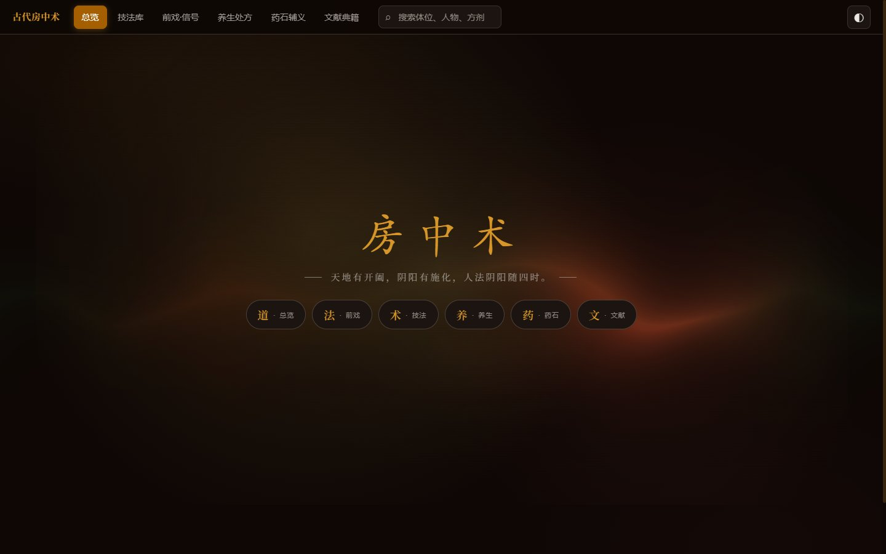
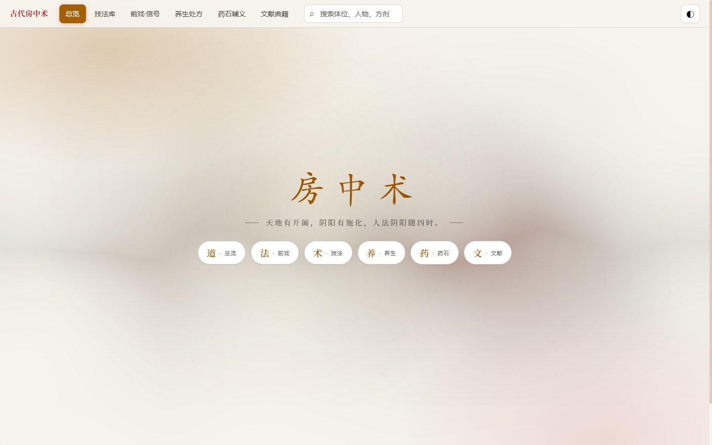

# 房中术 · 知识看板（开源版）

**一个离线可用、单文件交付的中国古代房中术知识看板。**

中国古代医学把性健康视为养生的一部分。汉唐之间成书的《素女经》《玉房秘诀》《素女方》，以及经《医心方》保存的佚文，记录了对性生理、唤起信号与养生方法的系统观察。本项目把这些散落的文本整理成一个可浏览的单页看板：古籍原文对照现代解读、技法、养生功法、药石方剂与文献源流。

**为什么开源？** 这类知识在中英文世界里，要么被低俗化成段子，要么沉睡在无法检索的影印本和绝版书里，没有一个结构化、可引用、能被公众纠错的共同版本。这个项目想成为那个版本——每条论断都能追溯到古籍或现代文献，每处修正都在公开记录里审阅。

> **说明**：性健康与古典医学的教育性内容，不构成医疗建议。面向成年读者；含古画与示意剪影（剪影不随仓库分发，见下文许可证部分）。

## 在线版

**https://Lanren152.github.io/fangzhongshu/**（GitHub Pages 自动部署）

## 界面





## 内容

六页、59 条技法、134 张卡片：

- **总览** — 道 / 法 / 术 / 养 / 文 五条线索
- **技法库** — 九法、八益、三十法、现代体位，共 59 条，含操作指引与解剖要点
- **前戏·信号** — 四至、九气、五徵、五欲、十动，古人的信号体系
- **养生处方** — 七损八益、呼吸、频次、日常练习
- **药石辅义** — 经典方剂与单味药，附出处
- **文献典籍** — 典籍本身与历史人物

## 本地运行

```bash
git clone https://github.com/Lanren152/fangzhongshu.git
cd fangzhongshu
npm run build        # 生成 dist/index.html（单文件）
```

只需要 Node 18+，无任何 npm 依赖。`src/index.html` 也可以直接用浏览器打开开发调试。

## 征集可视化素材

公开版本没有随附体位示意图：原剪影素材来源无许可证，已移除。纯文字卡片能用，但一张好的示意图，能让一个陌生的体位在两眼之间被读懂。

解剖示意需要设备和技能，不是每个人都具备——所以这是一件该由社区一起完成的事。如果你能贡献以下任何一类，非常欢迎：

- **体位示意图** —— 59 条技法的抽象剪影或线描。取向中性、解剖示意，不是露骨图片。
- **古典风格插画** —— 与现有公有领域古画风格一致的线描、木刻风药材、人物与场景。
- **数据可视化** —— 四至、九气、五徵、五欲、十动目前是普通表格；人体图、时间轴、交互式图表会更有表现力。
- **无障碍变体** —— 高对比度版本、减动效静态图、图片替代文本审校。

要求：必须是你自己的作品，或与 CC BY-SA 4.0 兼容的授权；SVG、WebP 或 PNG；与 `src/css/main.css` 的设计 token 一致。接入方式见 [assets/img/poses/README.md](assets/img/poses/README.md)：图片放进 `assets/img/poses/`，在 PR 中声明权利归属。若由生成模型产出，请注明模型名称并确认你拥有分发权。整套提交前先开 Issue（标题「Visual assets: …」），先把风格对齐，再画 59 张。

## 一起共建

欢迎贡献，尤其是**带出处的古籍校订**。详见 [CONTRIBUTING.md](CONTRIBUTING.md)。

优先方向：

- 古籍原文校勘（给出篇目、版本出处）
- 现代医学事实核查（附参考文献）
- 英/日文翻译
- 无障碍与浏览器兼容
- 新板块与可视化

## 许可证

| 部分 | 许可 |
|---|---|
| 源代码 | [MIT](LICENSE) |
| 文本内容、翻译、编辑写作、设计 | [CC BY-SA 4.0](LICENSE-CONTENT) |
| `assets/img/art/` 的古画 | 公有领域（Wellcome Collection、Wikimedia Commons、《植物名实图考》） |
| 体位剪影 | **不随仓库分发**。源图库无许可证，应用自动降级为纯文本。见 [assets/img/poses/README.md](assets/img/poses/README.md) |

## 构建方式说明

本项目在 AI 辅助下开发：代码、编辑结构与设计迭代由 Claude Code 完成，人工审校；内容初稿亦使用 DeepSeek 辅助。所有合入的改动都经过人工复核，事实性表述对照文献出处核查。欢迎以「审 AI 产出」的视角提交 Issue 和 PR——本项目希望成为 AI 辅助开源的一个可检验样本，不回避这一点。

## 免责声明

本项目是关于历史医学文献的知识保存与教育项目，不构成医疗建议。古籍方剂可能含有违法、有毒或危险的物质，请勿擅自配制或服用。任何健康问题请咨询执业医师。

---

[English](README.md)
